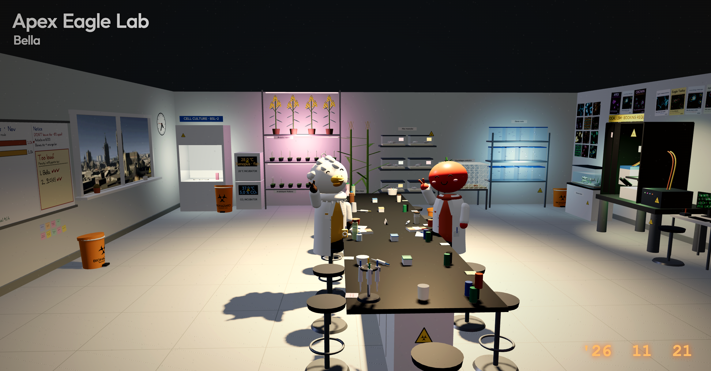
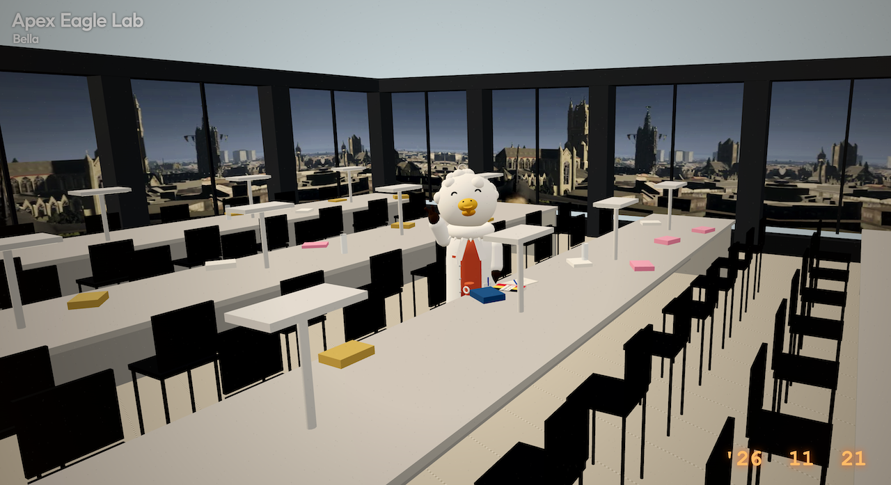
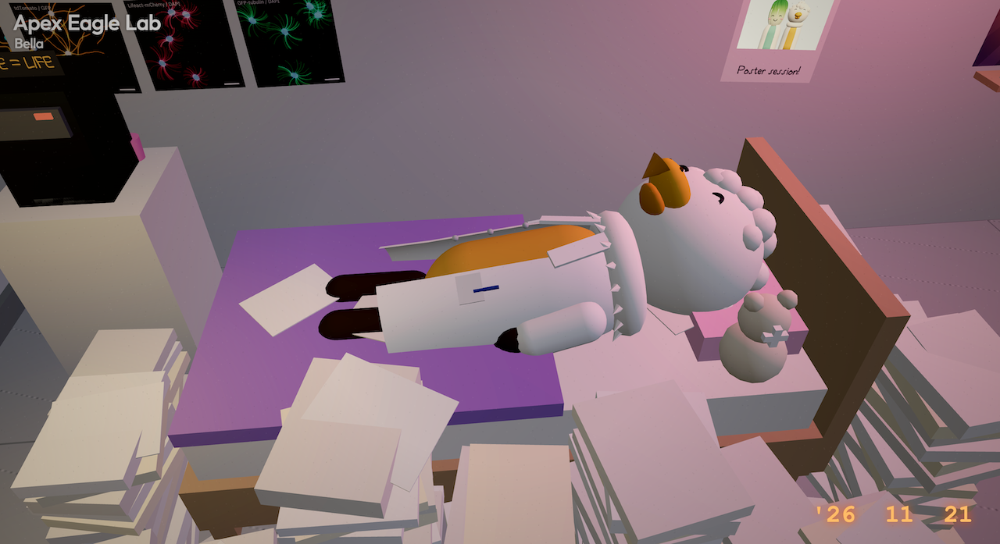

# 🦅 Apex Eagle Lab

**A quiet 3D lab bench where grad students study together, head to head!**

👉 **Open the lab: [sohykim.github.io/apex-eagle-club](https://sohykim.github.io/apex-eagle-club/)**

No install, no email. It works in your browser on a laptop or a phone, in landscape or portrait. The site is available in English and Korean (한국어).

---

## 🆕 What's new (v1.6)
- 👥 Friends: add by nickname, see who's online
- 🛏 Rest options: nap in the bed or zone out at your seat
- Updated on November 21st, 2026

[See all updates →](CHANGELOG.md)

---

## What is this?

Writing a thesis alone at 2 a.m. is lonely. Here you join a virtual lab as a little character: an eagle by default, or a vegetable if you prefer. You sit at a shared bench with your friends. When you focus, everyone bows their head until your crowns touch, and you work in silence together.

It's a body-doubling space for researchers, with some lab chaos: messy reagent shelves, a whiteboard full of half-finished calculations, plants that wilt if nobody waters them, and a neon sign that says *I want to graduate*.

## Get started in 1 minute

1. **Pick a language**: English or Korean.
2. **Sign up** with:
   - a **nickname** (up to 20 characters)
   - a **4-digit PIN** 
   - the **country** you live in (will be shown as a flag 🇧🇪)
   - your **field of study** (e.g. Plant biology, Biomedical, Microbiology, Physics, Mathematics, Bioinformatics,...)
3. **Choose a room to focus**:
   - 🧪 **Create a new lab**: give it a name and a size (2–14 people). You get a 6-character code and a link to share.
   - 🔑 **Enter a lab**: type a code a friend sent you, or just open their link.
   - 🧪 **Join the public library**: you can join the room without a code up to 100 people. 

      

   - 👑 **Eagle VIP Club**: only for people approved by the developer. Send a request and wait for approval.
4. **Pick a spot to sit**: pick your character, point color and today's task. Put yourself head to head and start focusing! One session lasts 30 minutes and after each session you get a chance to water the plants or feed the laboratory animals. 
5. **Rest**: You can take a rest either sitting still or taking a nap on the bed in the corner (max 1 person). 

You can log in with the same nickname and PIN on any device.

## Connect with your friend
You can search your friend by their nick name and send friend request. 
In your friend list, you can see whether they are active and which study room they are in.
You can enter your friend's study room without the invitation code. Enjoy!

## While you're in the lab

| Button | What it does |
|---|---|
| **Focus / Break** | Focus bows your head toward the others and starts your timer. Break lets you lean back with a coffee ☕. |
| **Get angry!** | For when the Western blot fails again. 💢 |
| **Chat** | Press Enter to chat. Talk too much and your name goes on the whiteboard. |
| **Bench view / Face view** | Change the camera. You can also tap the whiteboard, plants, animals or the confocal microscope to look closer. |
| **📸 Capture** | Everyone smiles and makes a peace sign ✌️. The photo gets a film-camera date stamp. |
| **Care** | Water the plants 🌱 and feed the mice, rabbit, zebrafish and frogs 🐭🐰🐟🐸. |
| **My research journey** | Your focus time, sessions, streak, monthly calendar, account settings and language. |
| **Attendance** | Who is here now, who came today, and the weekly record. |

Your name tag shows your flag and your field of study while you focus.

## Little rules of the lab

- **Sessions are 30 minutes.** Each finished focus session earns you one care action to either water the plants or feed the lab animals.
- **Care resets every 15 minutes.** You also get one free care when you arrive.
- **The whiteboard keeps score.** It shows a monthly study-hours graph, and the month's top studier gets a framed portrait by the door. 🏆
- **Lab managers** (whoever created the lab) can change the whiteboard notice and the neon sign, and clear the chat.

## FAQ

**I forgot my PIN.**
There's no email, so there's no reset link yet. You'll need to make a new account. Write your PIN down somewhere safe.

**Can my friends see my data?**
Other people in your lab can see your nickname, flag, field of study, focus time and chat messages. Each lab keeps its own records.

**Is my PIN secure?**
It's a 4-digit PIN for a study room, not a bank. Don't reuse a PIN you use anywhere important.

**Why do I see "BE" instead of a 🇧🇪 flag?**
Windows doesn't draw flag emojis. Mac, iPhone and Android do.

**Something's broken, or I have an idea.**
Open *My research journey → Send feedback* by clicking the biohazard bin or go to your account page. Only the developer can read it.
You can also send an email to me: sohyung.bella.kim@gmail.com. 

---

This webiste is generated with the help of generative AI by Claude Code and powered by Google Firebase.
*Made for grad students who need a little company to keep going. Head to head, soar like eagles!* 🦅
